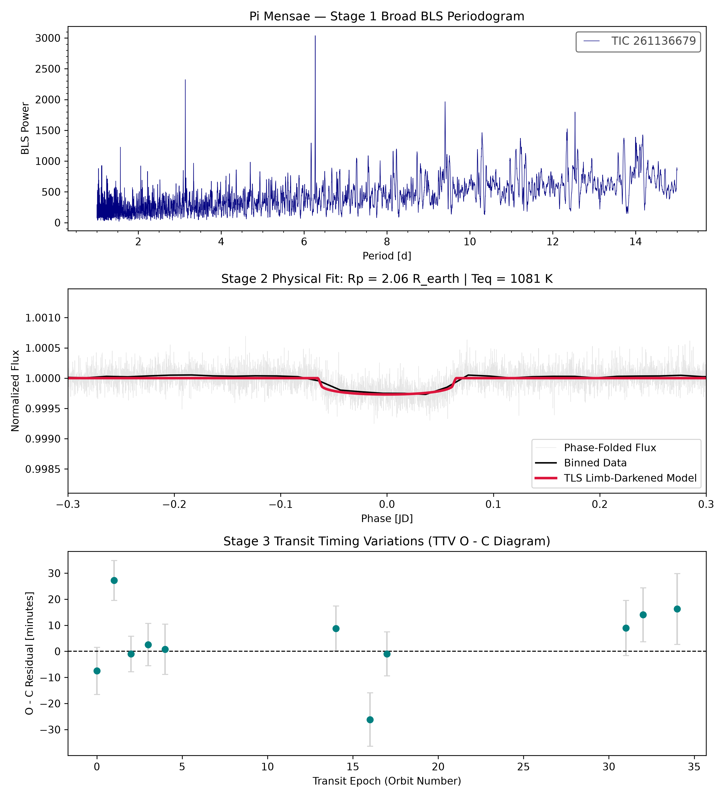

# Multi-Sector Exoplanet Transit & Characterization Suite

An end-to-end, object-oriented Python pipeline for automated TESS photometric detrending, multi-sector stitching, two-stage blind transit detection (BLS + limb-darkened TLS), false-positive vetting, and physical exoplanet characterization.



## Pipeline Architecture
- **`src/fetcher.py` (`LightCurveFetcher`):** Queries NASA MAST archives via `lightkurve` to ingest multi-sector TESS SPOC short-cadence light curves.
- **`src/cleaner.py` (`LightCurveCleaner`):** Applies $5\sigma$ cosmic-ray outlier clipping, Savitzky-Golay polynomial detrending, and median flux normalization across stitched sectors.
- **`src/detector.py` (`TransitDetector`):** Executes broad blind Box Least Squares (BLS) periodograms with iterative transit masking for multi-planet searches.
- **`src/vetter.py` (`TransitVetter`):** Performs physical limb-darkened Transit Least Squares (TLS) refinement and Odd/Even transit depth validation ($<3\sigma$ threshold) to eliminate eclipsing binary false positives.
- **`src/characterizer.py` (`PlanetCharacterizer`):** Queries the TESS Input Catalog (TIC) via `astroquery` to derive planetary radius ($R_p$), semi-major axis ($a$), equilibrium temperature ($T_{\text{eq}}$), and individual transit midpoints for Transit Timing Variation ($O - C$) analysis.

## Benchmark Results: Pi Mensae c (TIC 261136679)
Validated across TESS Sectors 1, 4, and 8 (`45,306` data points):
- **Refined Orbital Period ($P$):** `6.267605 days` (`SNR = 40.9`)
- **Transit Depth ($\Delta F$):** `269.7 ppm`
- **Odd vs. Even Depth Consistency:** `2.23 sigma` (`PASSED`)
- **Derived Planetary Radius ($R_p$):** `2.06 R_earth` (Literature: `2.04 +/- 0.05 R_earth`)
- **Semi-Major Axis ($a$):** `0.0687 AU`
- **Equilibrium Temperature ($T_{\text{eq}}$):** `1081 K` ($A_B = 0.3$)

## Installation & Testing
```bash
conda env create -f environment.yml
conda activate exoplanet
pytest -v
python main.py
```

